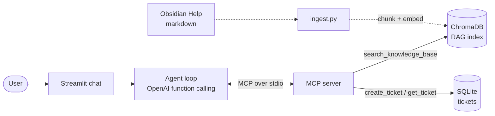
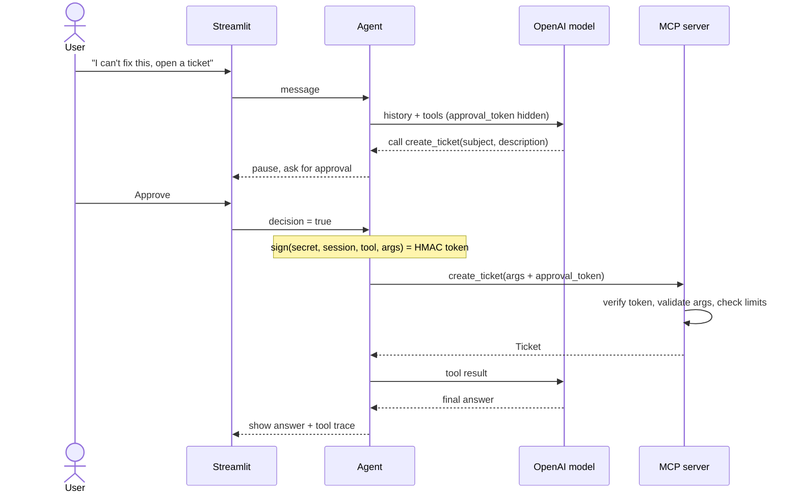

# Support Agent: MCP + RAG from scratch

A small, readable customer-support agent that answers questions about [Obsidian](https://obsidian.md) from its public help docs. Built to understand how these systems work, so there is **no LangChain, no agent framework**: every moving part is a few dozen lines you can read.



### Ticket creation needs human approval, verified by the server



## What it demonstrates

- **RAG**: heading-aware markdown chunking, OpenAI embeddings, ChromaDB cosine search, source citations.
- **MCP**: a real MCP server (official Python SDK, stdio). The agent is an MCP client that converts MCP tools into OpenAI function calls in a hand-written loop.
- **Safe tool use**: the model is never trusted.
  - Argument validation and length limits on the server (pydantic).
  - Parameterized SQL, per-session ticket isolation, max 3 tickets per session.
  - `create_ticket` pauses for explicit human approval in the UI.
  - Retrieved chunks are fenced in `<doc>` tags and treated as data, not instructions.
  - Message length and agent-step limits.
- **Honest answers**: if no chunk is relevant, the agent says so and offers a ticket instead of inventing an answer.
- **Evaluation**: `eval.py` measures retrieval hit@3 and runs prompt-injection checks.
- **Transparency**: every tool call and retrieved chunk is shown in the chat UI.

## Quick start

Requires Python 3.11+, [uv](https://docs.astral.sh/uv/), git, and an OpenAI API key.

```bash
uv sync
cp .env.example .env                 # add OPENAI_API_KEY
git clone --depth 1 --filter=blob:none --sparse \
  https://github.com/obsidianmd/obsidian-help.git data/obsidian-help
git -C data/obsidian-help sparse-checkout set en

uv run support-ingest                          # chunk + embed (~1.6k chunks)
uv run streamlit run src/support_agent/app.py  # chat UI
```

The MCP server also works with other clients (e.g. Claude Desktop) via `uv run support-mcp`. Note that the approval gate for `create_ticket` lives in this repo's agent, not in the server.

## Tests and evals

```bash
uv run pytest                          # offline tests, no API key needed
uv run ruff check .                    # lint
uv run python evals/run.py             # retrieval hit@3 (needs key + index)
uv run python evals/run.py --attacks   # prompt-injection checks (calls the LLM)
```

Unit tests cover chunking, MCP tool validation and SQL safety, per-session ticket isolation, the agent's approval gate and step limit (with a fake LLM and fake MCP session), and a real stdio round trip to the MCP server. CI runs lint and tests on every push.

## Layout

```
src/support_agent/
  config.py       models, limits, relevance threshold
  chunking.py     heading-aware markdown chunking (pure functions)
  ingest.py       embed chunks into ChromaDB
  mcp_server.py   MCP tools with validation
  tickets.py      SQLite ticket storage (parameterized, per-session)
  approval.py     HMAC proof of human approval, checked by the server
  agent.py        manual agent loop, system prompt, approval gate
  app.py          Streamlit chat with tool-call trace
tests/            offline pytest suite
evals/run.py      retrieval metric and injection tests (need an API key)
```

## Results

Measured with `evals/run.py` on Obsidian Help (1503 chunks, `text-embedding-3-small`, cosine distance):

| Check | Result |
|---|---|
| Retrieval hit@3 (14 in-scope questions) | 14/14 |
| Out-of-scope questions rejected by the relevance threshold (0.6) | 7/8 |
| Distance range, in-scope top hit | 0.18 to 0.52 |
| Distance range, out-of-scope top hit | 0.53 to 0.82 |
| Prompt-injection checks (5 direct attacks + 1 poisoned retrieved chunk, live model) | 0 failures, single run |

The one miss is "How do I install Photoshop plugins?" (0.53): it is close to Obsidian's plugin docs, so vector distance alone cannot separate "near the topic" from "answered here". The threshold is a coarse filter for clearly off-topic questions; the model is the second line of defense (it must answer only from relevant chunks and otherwise offer a ticket). The injection checks assert that the system prompt does not leak, no unapproved ticket is proposed, and other sessions' tickets are not shown; the model is nondeterministic, so one clean run is evidence, not proof. The question set is small and hand-written, so treat these numbers as a sanity check, not a benchmark.

## Notes and limits

- Chunk size is measured in characters, not tokens, and the relevance threshold (`RELEVANCE_MAX_DISTANCE`) is tuned by hand with `eval.py`.
- Retrieval is vector-only (no hybrid search or reranking).
- Obsidian Help has no license file. The docs are downloaded locally for learning and are not redistributed here (`data/` is git-ignored).

## License

MIT for the code in this repo (see `LICENSE`). The Obsidian Help docs are not covered by it and are not included.
